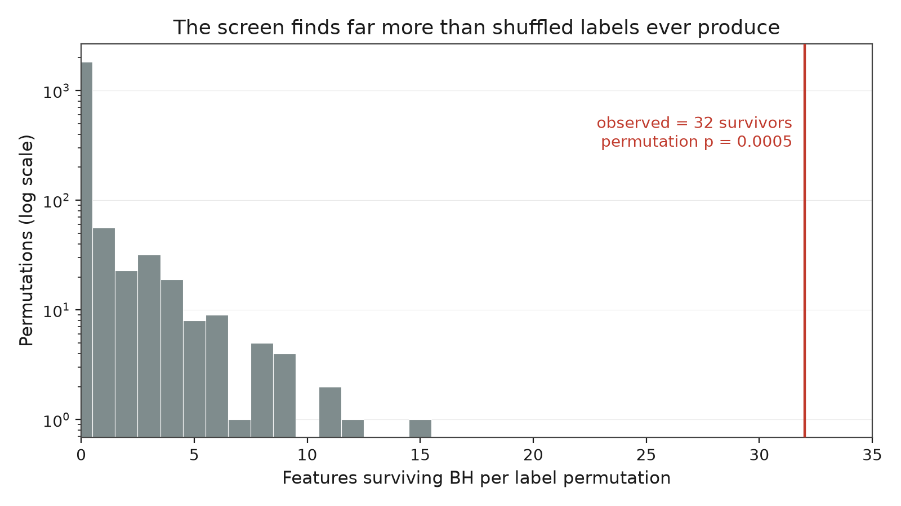
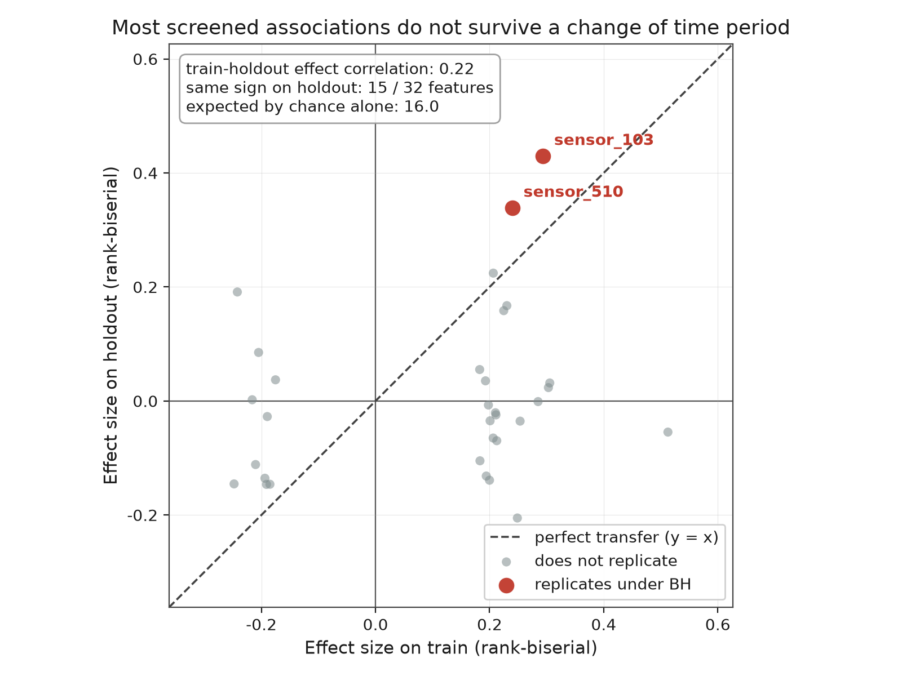
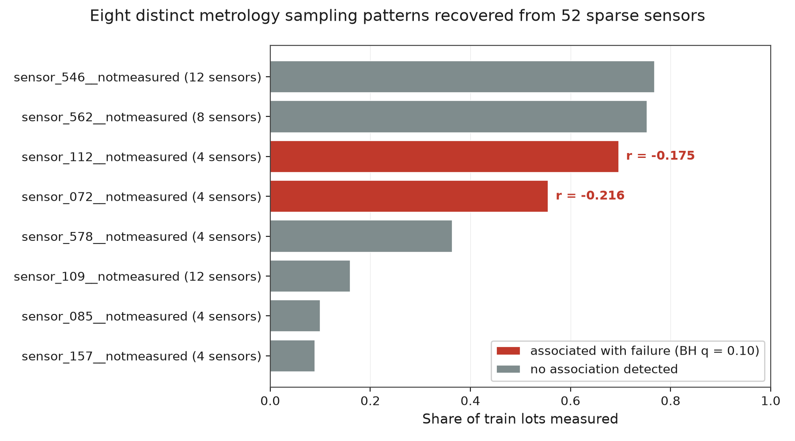
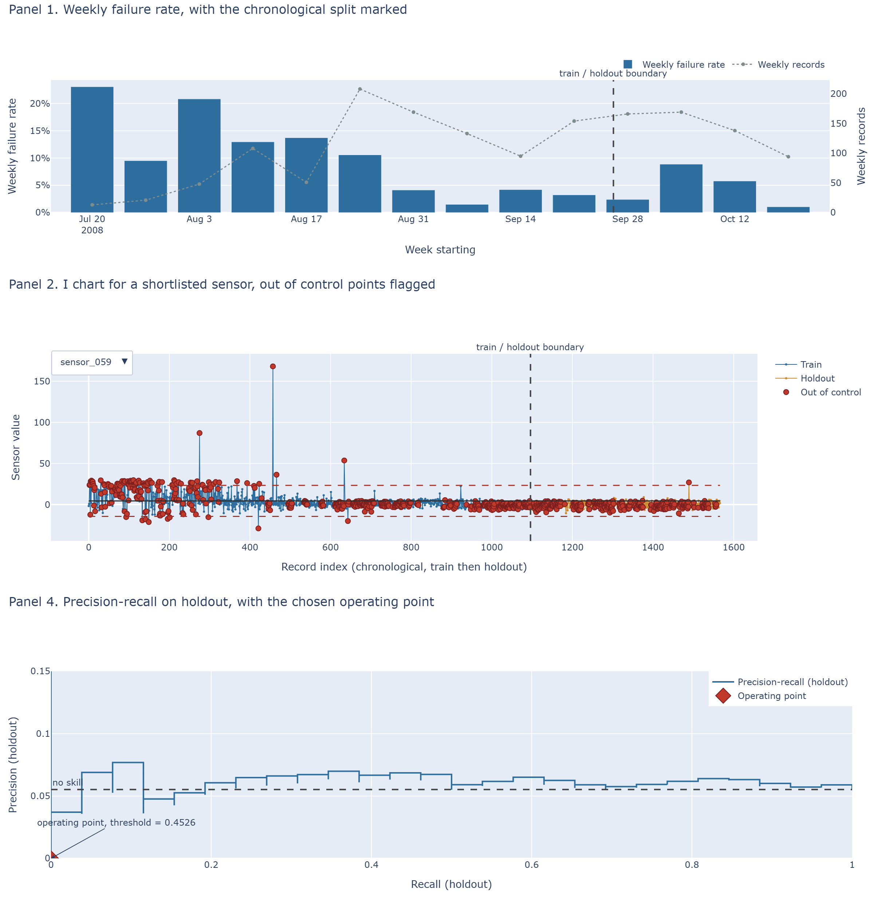

# Semiconductor yield detractor screening

[](https://github.com/AaroNLaU0307/semiconductor-yield-screening/actions/workflows/ci.yml)

Screening candidate yield detractors in a wide, imbalanced, heavily missing
semiconductor process dataset (UCI SECOM), with false discovery control, a permutation
null, SPC control charts, and a cost aware predictive baseline.

## Headline findings

### 1. The screen finds real structure, and most of it is an artifact of time

On the training period, **32 of 424 features cleared Benjamini-Hochberg at q = 0.10**.
Under the declared permutation null ([DECISIONS.md](DECISIONS.md) D6), across 2000 label
permutations 91.9 percent produced zero survivors, the null mean was 0.25 and the null
maximum was 15, against an observed 32: **permutation p = 0.0005**, the smallest value
2000 permutations can give. Testing 424 correlated things at once does not explain the
result.



That null shuffles the labels freely, as if they were exchangeable across time, and D0
records that they are not. A post-hoc sensitivity analysis reruns the whole screen, BH
included, on every circular shift of the time ordered train labels (all 1095 of them,
so no random draw is involved), which keeps the clustering of failures in time. The null
mean rises to 7.59, its 95th percentile to 27 and its maximum to 53, and 34 of the 1095
shifts reach 32 survivors: **p = 0.0319**. The screen still beats chance, but by a much
narrower margin than the free shuffle suggests. Details in
[reports/screening.md](reports/screening.md) section 4.

Recomputing those same effect sizes on the held out period tells a different story. Of
the 32 shortlisted features, only **15 keep the sign of their effect** (a coin gives
16), the median absolute effect size **falls by 63 percent** (0.210 to 0.077), and the
correlation between train and holdout effect size is **0.216**.



The cause is **non-stationarity: the distribution shifts across the very window the
model is fitted in.** The failure rate falls from 22.2 percent in July 2008 to 2.9
percent in September before rising to 6.1 percent in October, and **16 of the 32
shortlisted features carry a strong monotone trend with time**. When two quantities both
trend across a window, a test computed inside that window sees a strong association
whether or not either has anything to do with the other.

The clearest case is the top ranked sensor, `sensor_059`: train effect +0.51, holdout
effect -0.05, and its own monthly mean falls 12.20, 7.14, 0.19, -0.59 across the four
months, in the same direction as the failure rate. Nothing in that pattern requires it
to influence yield. Those monthly means come from `sql/monthly_sensor_means.sql` and are
tabulated for the six most affected sensors in
[reports/replication.md](reports/replication.md).

### 2. Two features survive the change of period

BH at q = 0.10 applied to the holdout, over the family of the **32 shortlisted
features** rather than the original 424:

| feature | train effect | holdout effect | holdout 95 pct interval | holdout BH adjusted p |
| --- | --- | --- | --- | --- |
| `sensor_103` | +0.294 | +0.430 | +0.211 to +0.640 | 0.0073 |
| `sensor_510` | +0.240 | +0.339 | +0.125 to +0.539 | 0.0587 |

Both intervals exclude zero. They are stratified bootstrap percentile intervals, 2000
resamples, the same standard [DECISIONS.md](DECISIONS.md) D10 already applies to PR-AUC,
and they are wide because 26 holdout failures cannot support anything narrower. For
scale: testing the same 32 uncorrected at alpha = 0.05 would yield about 1.6 by chance,
which is why the correction is applied rather than raw p-values quoted.

**Neither is contaminated by the sampling bias described below.** Both are dense band
sensors measured on 99.9 percent of train lots and 99.8 percent of holdout lots, so
neither is drawn from a sampled subpopulation. More decisively, the association survives
holding each failure associated sampling plan fixed: recomputed within every stratum of
both plans, all eight strata keep the same sign (+0.22 to +0.53 for `sensor_103`, +0.29
to +0.56 for `sensor_510`). Sampling bias is excluded as the explanation, not merely
argued to be inapplicable.

These are the project's positive output: the two candidates worth a process engineer's
time, because they are the only ones that held up when the time period changed.
Confirming them would need a third period this project has not touched. Full analysis in
[reports/replication.md](reports/replication.md), labelled post-hoc because it was added
after the model failed rather than planned at Gate 1.

### 3. The predictive model does not work, which is how the drift was found

Holdout PR-AUC is **0.062, with a 95 percent interval of 0.050 to 0.098**, against a
no-skill floor of 0.055. The interval contains the floor. ROC-AUC is 0.539. This is not
a working detector and should not be used as one.

The cost sweep makes the same point without any statistics. Across every threshold from
a 1 to 1 up to a 100 to 1 cost ratio, the best precision the model reaches is 0.069
against a base failure rate of 0.055. It first achieves full recall at a 46 to 1 ratio,
and it does so by flagging all 471 holdout lots, at which point precision equals the
base rate exactly. The only way this model catches every failure is to stop
discriminating.

A model that failed quietly would have ended the project. Asking why it failed is what
produced finding 1.

### 4. The SPC flags do not discriminate either

Out of control records fail no more often than in control records, at every severity
threshold under two rule sets, smallest BH adjusted p = 1.000.

**A defect in this project's own frozen design.** The out of control flag frozen at
Gate 1 defined a record as out of control if any applied Nelson rule fired on any
charted sensor. Applied to ten sensors with per sensor flag rates of 3 to 60 percent,
that flags **468 of 471** holdout records by construction and cannot discriminate
anything. The declared result is reported as specified rather than quietly replaced, the
flaw is attributed to the declaration, and a full severity sweep is added as a labelled
post-hoc diagnostic. See [reports/spc.md](reports/spc.md).

### 5. Which lots were measured is itself associated with whether they failed

Grouping the 52 sparsely measured sensors by their exact missing or present vector
recovers **8 distinct metrology sampling plans**, and **2 of those 8 clear the same FDR
threshold as the sensors themselves**: `sensor_072__notmeasured` (r = -0.216, adjusted
p = 0.0122) and `sensor_112__notmeasured` (r = -0.175, adjusted p = 0.0359). Lots that
were measured on those steps failed at roughly 9 percent against 3 to 4 percent for lots
that were not.

This is a **sampling bias finding, not a sensor finding**: it says something about how
lots were routed and selected for measurement, not about a process parameter. It is
reported because concealing it would protect a tidier narrative, and because any sensor
shortlisted from that same measured subpopulation would inherit the concern. Finding 2
discharges that concern for the two features that matter.

### 6. The caveat on all of it

The holdout contains **26 failures**. Every holdout number here carries a wide interval,
and this is weak evidence of no effect rather than evidence of no effect.

## Why this repository looks different from other SECOM analyses

SECOM is heavily used and many published analyses report far stronger numbers. Before
comparing, check the protocol. Random cross validation on time ordered records,
oversampling applied before the split, and feature selection performed on the full
dataset each inflate the reported figure without improving the detector. The numbers
here come from a chronological split with every transform and the entire screen fitted
on the train partition alone, so **they are not comparable to numbers obtained under
those protocols, and they are not offered as a competitor to them.**

The differentiator is not the score. It is that the protocol supports the score.

## Method

Records are sorted by timestamp and split chronologically at 70 percent (1096 train,
471 holdout, boundary 2008-09-26). Column drop rules, median imputation and the feature
screen are all fitted on train only.

### Where the data comes from

The pipeline reads from a local **DuckDB** warehouse rather than from flat files,
because that is where fab process data lives: a yield analyst's work starts with a query,
not with a file read. The two raw files are landed into `data/secom.duckdb` in long form,
one row per measured cell (`record_id`, `sensor_id`, `value`), which is how sensor data
is actually warehoused and what makes coverage and missingness natural aggregations.

The division of labour is deliberate: **SQL does extraction, filtering and aggregation;
Python does inference.** Queries live in [`sql/`](sql/), one file per concern. There is
no Mann-Whitney U or BH correction in SQL. `tests/test_warehouse.py` asserts that the
SQL drop rules agree with the pandas implementation sensor by sensor, and that data read
back from the warehouse is bit identical to the raw parse.

### Missingness, and the structure hiding in it

Sensors turn out to be either near-complete or catastrophically sparse, with **no sensor
having a train missing rate between 2 percent and 20 percent**. That empty band is why
the dense band ceiling is not a tunable parameter: any value inside it produces an
identical partition. Dense sensors (416) keep their values and are median imputed.
Sparse sensors (52) have their values dropped and contribute a binary not-measured
indicator instead, because imputing a sensor observed for one lot in five manufactures a
column that mostly carries the missingness pattern.

Grouping those 52 sensors by their exact missing or present vector is **unsupervised
structure discovery over the missingness matrix**, by exact grouping rather than by a
clustering algorithm, because the patterns are exact. They collapse to **8 distinct
patterns**, which is the signature of metrology sampling plans rather than of sensors
failing independently.



Two of those patterns are themselves associated with failure under the same FDR control.
That is a **sampling bias finding, not a sensor finding**: which lots were measured is
associated with whether they failed, and any sensor shortlisted from those same lots
inherits the concern.

### Outliers, detected and reported but never removed

Detection is robust: a value is flagged when it lies more than 5 scaled median absolute
deviations from its sensor's median, since a mean and standard deviation rule finds
fewer outliers exactly when there are more of them. On train, **343 of the 457 sensors
that have a robust scale carry at least one flagged value**, 8351 cells in total, and
the most extreme sits at a robust z of about **199,000**.

Nothing is removed, winsorised or clipped. Deleting an inconvenient reading from process
data destroys the evidence that a tool did something unusual. They are handled instead
by choosing methods that tolerate them, which is why the screen is rank based, the
imputation uses the median, and the effect size is rank-biserial: a value 199,000 robust
deviations out contributes exactly one rank. SPC is the one place this bites, and
`reports/spc.md` says so. Full detail in
[reports/data_quality.md](reports/data_quality.md).

### Screening, SPC and the model

Each of the resulting 424 features is tested against the label with a two sided
Mann-Whitney U test (tie corrected, because imputation creates large tie blocks),
reported with a rank-biserial effect size, and corrected with Benjamini-Hochberg at
q = 0.10. The whole screen, BH correction included, is then rerun on 2000 label
permutations and, as a post-hoc sensitivity analysis, on every circular shift of the
time ordered labels.

Shortlisted sensors get I-MR charts with limits computed on train, and out of control
flags are cross referenced against actual holdout failures with Fisher's exact test.
One class weighted gradient boosting model provides the predictive baseline, with the
grid point and the decision threshold both selected on train out of fold predictions
before the holdout is scored once.

Every threshold was fixed in [DECISIONS.md](DECISIONS.md) before any modelling code was
written, and frozen at an owner approved gate.

### One result deliberately not promoted

The secondary L2 logistic model scored higher on the holdout (PR-AUC 0.104) than the
declared primary (0.062). It is **not** promoted to the headline. The primary was named
before any holdout record was read; swapping it afterwards is model selection on the
evaluation set. ROC-AUC also ranks the two the other way round, and the intervals
overlap, so the ordering is noise. Details in [reports/model.md](reports/model.md).

## What the data physically represents

SECOM records are **inline sensor measurements**, taken from process tools as lots run
rather than from finished die. That matters for what a shortlisted sensor can mean. In a
real flow, inline signals sit upstream of parametric (param) measurements taken on test
structures at end of line, and further upstream still of probe results measured on the
die themselves. An inline sensor associated with a pass or fail flag is separated from
the electrical outcome by every step that follows it, so it is a candidate for
investigation rather than a diagnosis.

The 8 missingness patterns look like **metrology sampling plans**: not every lot is
measured on every tool, because measurement costs throughput. Lots are sampled, and the
sampling rule shows up in the data as a block of sensors that are all absent together.

The drift in `sensor_059` has the shape a **tool drift or a chamber change** would
produce: a level that moves steadily across months rather than jumping with a lot.
Distinguishing that from a real yield relationship is not possible from observational
records. It takes a designed experiment, and
[reports/doe_proposal.md](reports/doe_proposal.md) specifies one for the two sensors
that did replicate, `sensor_103` and `sensor_510`.

## Dashboard



*Three of the dashboard's four panels, rendered by `scripts/build_readme_image.py` from
the same figure builders the dashboard uses, so the preview cannot drift from the real
thing. Panel 3, the ranked detractor table, is plain HTML and has no rasterised form.*

`dashboard/index.html` is a single self contained file. Open it directly from disk: no
server, no install, no internet. Verified rather than asserted: the page has no external
`script`, `link`, `img` or `iframe` tag, and loading it issues exactly one network
request, for the page itself. Four panels, each captioned with what to conclude: failure
rate over time with the split marked, a selectable I chart with out of control points
flagged, the ranked detractor table, and the precision-recall curve with the chosen
operating point.

Panel 2 is worth a look even in the preview. The spread of `sensor_059` collapses around
record 450 and never recovers, which is the drift in finding 1 made visible on a single
sensor.

## Running it

Python 3.11, the version CI uses. `requirements.txt` pins every package, transitive ones
included, to an exact version.

```
pip install -r requirements.txt
python scripts/run_data_qa.py
python scripts/run_pipeline.py
python scripts/build_dashboard.py
python scripts/build_doe_proposal.py
```

The warehouse is built automatically on first run from the committed raw files, so no
database setup is needed. The pipeline is deterministic: the same seed produces byte
identical reports, which is enforced by a test that runs it twice into a temporary
directory, compares the two runs byte for byte, and compares both with the committed
files. The markdown reports match those exactly. In the CSV and JSON files the last
digits of a few floats depend on the machine (the logistic regression goes through a CPU
specific BLAS kernel), so there the comparison allows a relative tolerance of 1e-9.

## Reports

| report | contents |
| --- | --- |
| [reports/data_quality.md](reports/data_quality.md) | what the raw data actually contains, including the ugly parts, and the missingness pattern discovery |
| [reports/screening.md](reports/screening.md) | the screen, BH-FDR result, the declared permutation null and its time order preserving sensitivity |
| [reports/spc.md](reports/spc.md) | control charts, the degenerate declared flag, and the severity sweep |
| [reports/model.md](reports/model.md) | holdout metrics, cost sweep, permutation importance |
| [reports/replication.md](reports/replication.md) | post-hoc: why the associations did not transfer |
| [reports/doe_proposal.md](reports/doe_proposal.md) | the experiment that would settle causation, not executed |

Everything in `reports/` is generated by a script and is never hand edited.

## What this project does not establish

It does not establish that any sensor causes yield loss. All 590 sensors come from
observational records of a running process with no randomised intervention, so every
ranking here is a ranking of association. A shortlisted sensor may matter, may proxy
something that matters, or may simply move with tool age or product mix.

[reports/doe_proposal.md](reports/doe_proposal.md) specifies the designed experiment
that would settle it for the two sensors that replicated, `sensor_103` and `sensor_510`,
and computes its cost: detecting a halving of the failure rate would need roughly **1346
lots**. That number is the honest reason observational screening studies exist, and it
is also the reason the screen is worth running, since buying that evidence for 2
candidates is tractable and buying it for 590 is not. The factors are chosen from the
post-hoc replication, so the experiment is also the test on a fresh period that finding
2 says they still need.

Nor does a weak result here establish that no detractors exist. It establishes that none
is detectable across this time boundary, at this sample size, at this effect size,
through this preprocessing.

## Data

UCI SECOM, 1567 records, 590 sensors, 104 failures (6.64 percent), July to October 2008.

> McCann, M. and Johnston, A. (2008). SECOM [Dataset]. UCI Machine Learning Repository.
> https://doi.org/10.24432/C54305

The raw files are committed under `data/raw` so the pipeline runs offline, and are
stored byte exact (git end of line normalisation is disabled for that directory) so the
recorded sha256 checksums verify on a fresh clone.

| file | sha256 |
| --- | --- |
| `secom.data` | `20f0e7ee434f7dcbae0eea9ffff009a2b57f42d6b0dc9a5bd4f00782c0a3374c` |
| `secom_labels.data` | `126884cf453705c9e61a903fe906f0665a3b45ce3639e621edc5c93c89627e03` |
| `secom.names` | `6d91b0b46cdee03064ee3e3112f937c1b3f7fcd9933575794ec07974e6f1ea59` |

Checksums are verified on every load by `yield_screening/data_io.py`, and again before
the warehouse is built.

## Repository layout

| path | contents |
| --- | --- |
| [DECISIONS.md](DECISIONS.md) | every frozen methodological choice with reasons, plus an adversarial self review; dated corrections are in [docs/ADDENDUM_2026-09-27.md](docs/ADDENDUM_2026-09-27.md) |
| [PLAN.md](PLAN.md) | phase plan, module layout, test schedule |
| [`sql/`](sql/) | warehouse schema and the extraction, filtering and aggregation queries |
| `yield_screening/` | library code |
| `scripts/` | entry points |
| `reports/` | generated reports |
| `dashboard/` | self contained HTML dashboard and its data |
| `docs/` | figures embedded above, generated from the pipeline's own output, and the dated addendum to DECISIONS.md |
| `tests/` | test suite |
| `results/headline.json` | the headline in machine readable form, checked against its artifacts by `tests/test_headline.py` |

## Tests

```
pytest -q
```

Four properties are protected, each written in the phase that produced the code it
covers: temporal ordering of the split, fit scope (perturbing a holdout row cannot
change any fitted parameter), screening behaviour on planted signal and on pure noise,
and seed determinism. A fifth pins the screening statistic against `scipy` and
`statsmodels`, and pins the fast matrix path used for the 2000 permutations against the
readable reference path, because a permutation null computed from a subtly different
statistic than the observation looks rigorous and is worthless. A sixth asserts the SQL
layer changed no answer: same drop verdict, same drop reason, and bit identical
statistics against the pandas implementation, sensor by sensor.

Three further files were added on 2026-09-27. `tests/test_report_claims.py` checks that
sentences in the generated reports which assert a result agree with the tables they
summarise. `tests/test_stats_provenance.py` pins the sha256 of the source of every
statistics helper, so an edit to one cannot pass silently. `tests/test_headline.py`
checks `results/headline.json` against the artifacts it cites and recomputes its
p-value from the raw data.

On pure noise across 100 fixed seeds, the screen produced at least one survivor in 4
percent of runs, against a theoretical BH bound of 10 percent.

CI also fails the build on this project's banned typography: the em dash, plus the
look-alikes that fail the same way (a U+2212 minus sign is indistinguishable from a
hyphen and stops being a number when pasted into code). Other non-ASCII characters, such
as a diacritic in a cited author's name, are allowed.

## Licence

MIT, see [LICENSE](LICENSE). Copyright (c) 2026 Aaron Lau Chiong Wen.
